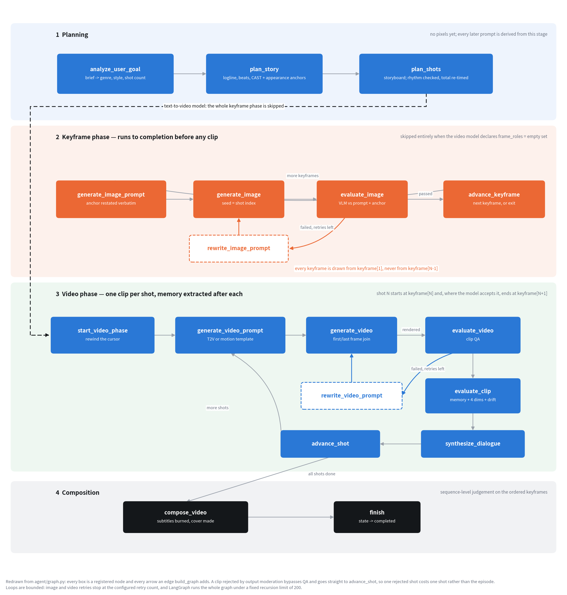
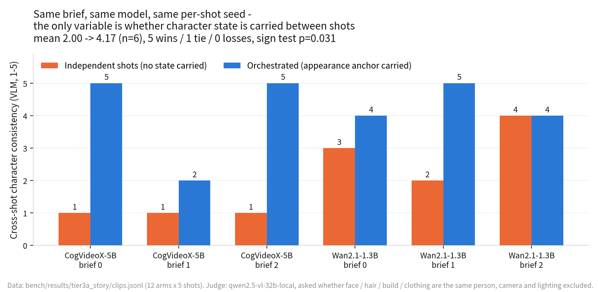
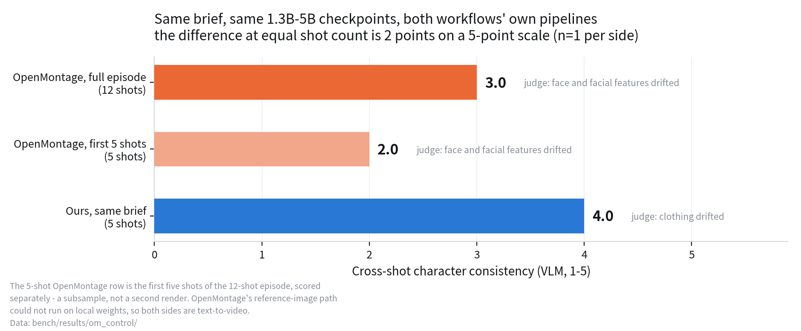
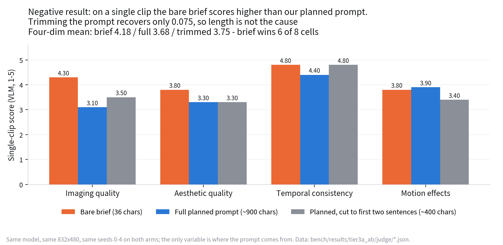
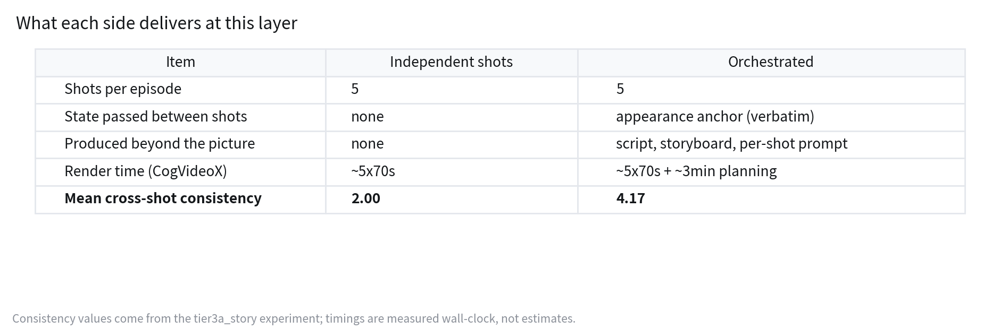

# Identity as Text, Identity as Pixels

> **Status.** This document records the single-pass experiment: each story was
> measured once. The repeated-measure version — three repeats per cell, histograms,
> paired tests — is [`technical_report.md`](technical_report.md), and its numbers
> supersede the headline figures here (2.28 → 4.61 over 18 paired episodes).
> The single-pass results remain valid for what they measured.

### A controlled study of multi-shot video orchestration on open-weight models

---

## Abstract

Multi-shot generative film has a failure that single-clip benchmarks cannot see: the
person in shot 1 and the person in shot 5 are different people. There are two ways a
pipeline can attack this — carry the character's identity as **pixels** (a reference
still, a conditioning keyframe) or carry it as **text** (an appearance description
restated in every prompt). This report measures what each choice costs and buys, on
1.3B–5B open-weight video models, using our orchestration layer (six mechanisms, one
LangGraph state machine) and a real deployment of **OpenMontage** as the reference
workflow.

Three results, all from the same set of renders:

| | Result | Sample | Significance |
| --- | --- | --- | --- |
| **A. Carried state vs none** | cross-shot character consistency **2.00 → 4.17** | 6 stories × 5 shots | sign test **p = 0.031** |
| **B. Single-clip quality** | **4.18 → 3.68** — our planned prompt is *worse* | 8 cells | per-cell p ≥ 0.33 |
| **C. Matched whole-workflow run** | OpenMontage **2.0** (5 shots) / **3.0** (12 shots) vs ours **4.0** (5 shots) | n = 1 per side | none claimed |

Finding B is a negative result and is reported as one: the layer does not make a
single five-second clip look better, it makes it look slightly worse. Findings A and C
are the positive claim, and they are the same claim seen twice — the layer exists to
make the *same person* appear in every shot, and that is a property of the sequence,
not of the shot.

The mechanism-level conclusion, developed in §6: **OpenMontage treats character
consistency as a precondition of rendering; we treat it as a target.** On a strong
image model both designs work. On the model tier this study uses, one of them produces
a film with drift and the other produces no film at all. That difference is structural,
it is visible in the two codebases, and it is what the numbers in §5 measure.

---

## 1. The question

A five-second clip can be judged on its own: is it sharp, is it well composed, does
the motion make sense. A five-shot film cannot. Its most important property — that the
same character walks through all five shots — is a relation *between* frames, and no
per-clip metric can express it. VBench-style dimensions score a clip; they do not
score a sequence.

So any workflow that produces more than one shot has to answer one question: **what
medium carries the identity from shot 1 to shot 5?**

Two answers exist in practice.

**Pixels.** Render (or select) a reference still of the character, then condition every
shot's first frame on it — either by handing the image model the reference, or by
animating the still with an image-to-video model. This is high bandwidth: a reference
image says more about a person than any paragraph. It is also a hard dependency: if the
reference is bad, everything downstream of it is bad.

**Text.** Describe the character once, in the story bible, and restate that description
verbatim in every prompt. This is low bandwidth — a text encoder reads perhaps 60 words
before truncating — but it is soft: a degraded description still names the person, and
a model that cannot render them well still renders *someone recognisably intended*.

Our layer uses both, but only the text carrier is load-bearing: the run completes on the
text alone. OpenMontage also uses both, and its pixel carrier is load-bearing: its video
stage will not start without per-character cutout plates that pass a vision gate.

This report measures the difference. §2 describes our workflow, §3 the reference one,
§4 the three experiments, §5 the results, §6 the mechanism analysis and the conditions
under which each design wins.

---

## 2. Our workflow



*Figure 1 — The state machine, redrawn from `agent/graph.py`. Every box is a registered
node and every arrow an edge `build_graph` adds.*

### 2.1 Topology

Eighteen nodes, seven modules, 1,508 lines:

| Module | Lines | Nodes |
| --- | ---: | --- |
| `agent/nodes/planner.py` | 427 | `analyze_user_goal`, `plan_story`, `plan_shots` |
| `agent/nodes/video_nodes.py` | 449 | `generate_video_prompt`, `generate_video`, `evaluate_video`, `evaluate_clip`, `synthesize_dialogue`, `advance_shot`, `start_video_phase` |
| `agent/nodes/image_nodes.py` | 166 | `generate_image_prompt`, `generate_image`, `evaluate_image` |
| `agent/nodes/repair_nodes.py` | 57 | `rewrite_image_prompt`, `rewrite_video_prompt` |
| `agent/nodes/composer.py` | 90 | `compose_video`, `finish` |
| `agent/prompts.py` | 199 | six system prompts |
| `agent/state.py` | 119 | state schema, persistence, usage accounting |

The graph has **six conditional edges**, and each one is a design decision rather than a
routing convenience:

| Decision node | Branch | What it decides |
| --- | --- | --- |
| `plan_shots` | `image` / `text_to_video` | whether a keyframe phase happens at all |
| `evaluate_image` | `retry` / `next` | whether a failed still is re-prompted or accepted |
| `advance_keyframe` | `more` / `all_done` | loop the keyframe phase, or start the video phase |
| `generate_video` | `skipped` / `generated` | whether a rejected clip is scored or skipped |
| `evaluate_video` | `retry` / `next` | whether a failed clip is re-prompted or accepted |
| `advance_shot` | `more` / `compose` | loop the video phase, or compose |

The whole graph runs under `recursion_limit=200` (`agent/graph.py`, `run_agent`), which
bounds the two retry loops together rather than each in isolation.

### 2.2 Mechanism 1 — dispatch by declared capability, not by model name

Every video provider declares what image roles it consumes:

```python
# mcp_servers/providers/base.py:88
frame_roles: frozenset[str]
```

An empty set means the model consumes no image — it is text-to-video. The graph reads
that declaration rather than a list of model ids:

```python
# agent/nodes/video_nodes.py:414
def needs_image_phase(state: AgentState) -> str:
    if not get_video_provider().frame_roles:
        return "text_to_video"
    return "image"
```

Three downstream behaviours all key off the same declaration, not off a hardcoded
model list:

- the **whole keyframe stage is skipped** for a T2V model (`needs_image_phase`);
- the **prompt template** changes: a T2V model gets `T2V_PROMPT_SYSTEM`, which must
  describe who is in frame, where, and in what light, because the model never sees a
  keyframe; an I2V model gets `MOTION_PROMPT_SYSTEM`, which describes a change from a
  frame the model does have (`video_nodes.py:29, 51, 71`);
- the **join policy** changes: `last_frame` → both ends authored; `first_frame` only →
  the previous clip's real tail; neither → no join at all (`video_nodes.py:133–151`).

This matters beyond tidiness. Whether a model is text-to-video is a *capability*, and
encoding it as one means the routing is derived from the model rather than duplicated
per model id at each branch point. The vendor workflow branches on backend identity in
several places; a new local model requires editing each of them.

The behavioural consequence was measured: with a T2V model, no keyframes are rendered
that nothing consumes, and every frame-derived metric is recorded as **not applicable**
rather than scored against a placeholder. A pipeline that renders a stage nothing uses
is not neutral — it publishes a number about a picture that never entered the film.

### 2.3 Mechanism 2 — the appearance anchor is a planning artifact, and it is enforced

`plan_story` asks the LLM for a story bible whose cast carries an explicit appearance
and wardrobe per character (`planner.py:66–105`). `shot_anchor` concatenates the
anchors of whichever characters appear in the current shot (`image_nodes.py:24–32`):

```
周平: square face, short buzz cut, scar through the left eyebrow… (wardrobe: dark grey work jacket…)
```

`generate_image_prompt` passes that string with the instruction *必须逐字保留* — preserve
verbatim — and then **checks the result**:

```python
# agent/nodes/image_nodes.py:52
if anchor and anchor.split(":")[0] not in prompt:
    prompt = f"{prompt} Character appearance: {anchor}."
```

This is a post-condition on an LLM output. A prompt instruction is a request; the check
is the guarantee. The same pattern appears in the storyboard (§2.6), and it is the
single most transferable engineering idea in this codebase: when a property matters,
verify it in code and repair it, rather than asking the model nicely.

### 2.4 Mechanism 3 — an anchor, not a chain

Every keyframe after the first is conditioned on **keyframe[1]**, never on
keyframe[N−1] (`image_nodes.py:65–91`). The comment records why:

> Every later keyframe is drawn from that one anchor, never from the previous shot's
> keyframe. Chaining N from N−1 compounds the model's small errors and a real run
> drifted far enough that the courier's blue uniform turned into a yellow hi-vis vest
> by shot 5. Re-deriving each frame from the same reference keeps drift from
> accumulating, and the per-shot scorer measures against that same anchor so any
> remaining drift is still visible as a number.

Chaining is the obvious implementation — each shot inherits the previous shot's look,
so the cut is continuous — and it is wrong for a sequence longer than three or four
shots, because a diffusion model's error is not zero-mean. Re-deriving from a fixed
anchor bounds the walk. The scoring reference is the same fixed anchor, so residual
drift appears as a per-shot number (`drift_vs_anchor`) rather than as a judgement call.

### 2.5 Mechanism 4 — the image phase runs to completion before the video phase

`start_video_phase` rewinds the shot cursor only after every keyframe exists:

> Image phase first, video phase second: shot N needs keyframe[N+1] as its final frame,
> which only exists after every keyframe has been rendered. (`agent/graph.py`)

This is what makes the `authored` join possible: shot N runs keyframe[N] → keyframe[N+1],
so both ends are pictures the image model drew from the bible's anchors, and drift
cannot accumulate. For a model that accepts only a first frame, `_previous_tail_frame`
(`video_nodes.py:81`) extracts the previous clip's real last frame and joins on that,
trading a small inherited error for a seamless cut. Which policy ran is recorded in the
event log as `join: none | authored | tail-to-head`.

### 2.6 Mechanism 5 — constraints are checked, not requested

The storyboard prompt states a rhythm: at least one 8-second long take, no three
consecutive shots of equal length, total within ±2 s of the target. Writing that in the
system prompt was not enough:

> a real run came back 5/9/6/4/4/4, three identical tail shots. A stated requirement
> that nothing verifies is just a suggestion. (`planner.py:228`)

So there are two programs. `rhythm_problems` (`planner.py:228–260`) turns the stated
rules into checks; if any fail, the model is handed **its own numbers and the rule it
broke**, which works far better than repeating the rule in isolation. Then
`fit_durations` (`planner.py:112–218`) enforces the total by re-timing: it reserves the
long take first, then moves one second at a time toward the target on the shot furthest
from its proportional share, then breaks runs of three by trading seconds between
neighbours. The ordering of constraints is explicit — total is hard, long take is hard,
no-triple is best effort — because they do not always coexist (six shots over 30 s with
three already at the floor forces 4,4,4).

This is the same principle as §2.3 applied to a different failure: **the model proposes,
the program disposes.**

### 2.7 Mechanism 6 — a failure removes its own unit, not the container

```python
# agent/graph.py
# A clip rejected by output moderation has no pixels to score and no track to lay
# under it, so it goes straight to the next shot. Before this edge existed, one
# rejected clip raised out of the whole run and discarded the episode — every other
# shot in it had already been rendered and paid for.
```

`clip_was_generated` routes a moderated shot past QA to `advance_shot`, and
`compose_video` drops any shot without a `video_path`. The episode ships one shot short
instead of not at all.

This is the same architectural choice as §2.8 and, in a real sense, the same choice that
distinguishes the two workflows in §6: **scope a failure to the smallest unit that can
carry it.**

### 2.8 What the state carries between shots

`AgentState` (`agent/state.py:15–52`) is a typed dictionary, persisted after every node
so the frontend can poll a crash-safe snapshot. The fields that matter for
cross-shot behaviour:

| Field | Written by | Consumed by |
| --- | --- | --- |
| `characters[]` (with `appearance`, `wardrobe`) | `plan_story` | every image and T2V prompt |
| `beats[]` | `plan_story` | `plan_shots` (must cover all, in order) |
| `shots[]` (scene, size, camera, duration, prompts, paths, scores) | `plan_shots` onward | everything |
| `keyframe_memory` (anchor, per-shot drift) | `evaluate_clip` | the drift metric, the anchor reference |
| `usage` (tokens per stage, media calls) | every LLM and media call | episode costing |

The important structural point: **the identity that crosses a shot boundary is a string
in this dictionary**, not a tensor and not a file handle. That is why the run survives a
weak image model — the string does not degrade when the renderer does.

---

## 3. The reference workflow

OpenMontage (vendored at `bench/_vendor/OpenMontage`, unmodified) is a full studio: a
project/shot/segment data model, an entity bible, image and video backend registries,
vision QA on both stills and clips, and an `auto-produce` pipeline that drives the whole
thing. Three of its properties matter here, and all three are read from its source, not
inferred.

**Its consistency mechanism is a chain of pixels.** Entity bible → per-entity reference
still → vision QA gate → shot keyframe conditioned on that still (`refPath`) →
image-to-video. The reference image is what makes shot 5 the same person as shot 1.

**That chain is gated, not advisory.** `entity_ref_qa_blockers`
(`studio/server/drama_service.py:2867`) returns a blocker for any referenced entity
whose selected still is missing, or whose QA is a soft pass, or which fails:

```python
meets = bool(img.get("qaPass") is True) and qa_meets_bar(qa) and not soft
```

and `qa_meets_bar` (`studio/server/prompt_qa.py:93`) requires `pass` **and** a numeric
score at or above `qa_min_score()`. With any blocker present, the video stage for those
shots does not proceed.

**It has a supported text-only path** — `textOnlyVideo: true` with
`generateEntities: false` skips the entity stage entirely and renders each shot from its
prompt. That path is what Experiment C runs, because the gated path cannot run on local
weights (§5.5).

Its backend registries are public (`VIDEO_BACKENDS`, `IMAGE_BACKENDS`,
`register_video_job`), which is how a local model was attached from outside the vendored
tree without editing a single vendored file.

---

## 4. Experimental design

### 4.1 Experiment A — carried state vs no carried state

| Arm | Prompt received per shot | State carried |
| --- | --- | --- |
| `independent` | the creative brief, verbatim (26–49 characters) | none |
| `planned` | the prompt **our pipeline wrote** for that shot (644–999 characters) | appearance anchor, restated verbatim |

Everything else is held constant:

| Item | Value |
| --- | --- |
| Base models | CogVideoX-5B, Wan2.1-T2V-1.3B |
| Resolution | 832×480 landscape (the one bucket both models share) |
| Seeds | per shot, `seed = shot index`; identical across arms |
| Shots per story | 5 |
| Briefs | 3, shared with the existing study layer |
| Sampling | 40 steps; guidance 6.0 (CogVideoX), 5.0 (Wan) |
| Total renders | 2 models × 3 briefs × 2 arms × 5 shots = **60** |

The `planned` prompts are **not written by hand for the experiment**. They are the
output of actually running `run_agent`; the experiment only reads `shots[i].motion_prompt`
off the resulting state. This is what makes the arm a measurement of the pipeline rather
than of the author.

### 4.2 Experiment B — single-clip prompt quality, with a length ablation

Same models, same 832×480, seeds 0–4, three prompt arms:

| Arm | Prompt | Characters |
| --- | --- | ---: |
| `brief` | the creative brief, verbatim | ~36 |
| `planned` | the pipeline's prompt for that shot | ~900 |
| `planned_short` | the same prompt cut to its first two sentences | ~400 |

30 renders. The third arm exists to separate *information* from *length*: if the planned
prompt loses because it is long, truncating it should recover most of the gap.

Judged on four VBench-style dimensions (imaging quality, aesthetic quality, temporal
consistency, motion effects), 1–5, by the same local VLM.

### 4.3 Experiment C — the matched whole-workflow comparison

Both workflows, on the same brief, driving the same class of checkpoint, scored by the
same judge:

> 深夜的便利店，一个外卖骑手发现收银员不是人。
> *(Night convenience store: a delivery rider discovers the cashier is not human.)*

**OpenMontage's side**: its own `auto-produce` endpoint, its own script / storyboard /
prompt stages, its own rendering, through the text-only path. Its local backends were
attached from outside the vendored tree:

- `bench/study/local_render_service.py` — a Flask GPU worker in `bench/.venv`, because
  the studio's own venv has no torch and installing one would modify the vendored
  checkout's environment;
- `bench/study/om_local_backend.py` — a thin HTTP client registered into
  `VIDEO_BACKENDS` and `IMAGE_BACKENDS`, plus `run_local_shot` bound into
  `providers.video_jobs` because the segment-QA path imports that symbol directly.

The resulting episode: 12 shots, **12/12 clips written back**.

**Our side**: `bench/study/ours_matched_arm.py` drives our pipeline on the identical
brief and renders the planner's prompts on the same checkpoint class: 5 shots.

Why 5 and not 12: each local clip is 30–70 s of GPU and the metric is a relation between
frames, not a function of shot count. The shot-count difference is disclosed in every
place the numbers appear, and the full 12-shot OpenMontage score is quoted alongside the
5-shot subsample.

### 4.4 The dependent variable and the judge

Cross-shot character consistency: the story's frames are handed to a local
Qwen2.5-VL-32B (temperature 0) which is asked whether these are the same person — face,
hair, build, clothing — with camera angle, background, lighting and colour grading
**explicitly excluded**. Scored 1–5.

The exclusion clause is the point. The metric must answer "is this the same person",
not "do these frames look similar", because the second question can be passed by a
pipeline that changes the person but keeps the palette.

Repeated asks on the same story were previously verified to return the same verdict, so
the judge is treated as deterministic at this setting.

### 4.5 Why this design can attribute a difference

Three confounds were removed deliberately, each because it had already contaminated an
earlier version of the study:

1. **Planner quality.** Both sides plan with the same LLM (DeepSeek). Had OpenMontage
   been left on the local 32B while ours used DeepSeek, the comparison would have
   measured planning capability, not orchestration. This also bounds the result: **no
   part of the measured difference is attributable to a better planner.**
2. **Canvas.** The first pass composited landscape output onto a 1080×1920 portrait
   canvas; `force_original_aspect_ratio=increase` then `crop` upscaled the clip 4× and
   cropped away 68% of its width. The judge was scoring that crop. Every number in this
   report was collected after the canvas followed the model's native output. See §7.7.
3. **Seed.** Repeats once reused a constant seed, so "repeat" meant different things on
   the two sides. Seeds are now fixed per shot and identical across arms.

---

## 5. Results

### 5.1 Experiment A — carried state raises cross-shot consistency



*Figure 2 — Same brief, same model, same per-shot seed. The only variable is whether
character state is carried between shots.*

| Model | Brief | Independent | Orchestrated | Δ |
| --- | --- | ---: | ---: | ---: |
| CogVideoX-5B | 0 | 1 | 5 | +4 |
| CogVideoX-5B | 1 | 1 | 2 | +1 |
| CogVideoX-5B | 2 | 1 | 5 | +4 |
| Wan2.1-1.3B | 0 | 3 | 4 | +1 |
| Wan2.1-1.3B | 1 | 2 | 5 | +3 |
| Wan2.1-1.3B | 2 | 4 | 4 | 0 |

| Statistic | Independent | Orchestrated |
| --- | ---: | ---: |
| Mean | **2.00** | **4.17** |
| Std. dev. | 1.26 | 1.17 |
| Range | 1–4 | 2–5 |

**5 wins / 1 tie / 0 losses**, mean improvement +2.17; one-sided sign test (ties
excluded, n=5) **p = 0.031**. Split by model: CogVideoX 1.00 → 4.00; Wan 3.00 → 4.33.

The mechanism is visible in the data. In the `independent` arm each shot receives only
the one-line brief, so the model invents a different person per shot; on CogVideoX all
three stories score 1 — not because the shots are badly drawn, but because there is no
same person across the five. In the `planned` arm every prompt restates the same
appearance anchor, so the judge can find the same person.

That also explains the shape of the gain: 2.00 → 4.17 converts "genuinely different
people" into "recognisably one person". It is not making a good picture better.

The one story that did not improve (Wan, brief 2, 4 → 4) is not a counterexample but a
bound: the independent arm already scored 4, meaning the model tends to produce
similar-looking people for that brief. **The size of the gain depends on how strongly
the brief already constrains the character in language.**

### 5.2 Experiment C — the matched comparison



*Figure 3 — Same brief, same checkpoint class, each workflow's own pipeline.*

| Arm | Shots | Cross-shot consistency |
| --- | ---: | ---: |
| OpenMontage, full episode, text-only path | 12 | 3.0 |
| OpenMontage, first 5 shots of that episode | 5 | **2.0** |
| Ours, same brief | 5 | **4.0** |

The judge's reasons name what drifted, and they are more informative than the scores:

> **OpenMontage, 5 shots (2.0):** *"the face and facial features are inconsistent across
> the frames, with some showing a person wearing glasses and others showing indistinct
> or obscured faces."*

> **Ours, 5 shots (4.0):** *"the main character's face, hairstyle, and body build remain
> consistent across most frames, but there is a noticeable change in clothing in Shot 4."*

Both sides lost something. Ours lost wardrobe on one shot and held the face; OpenMontage
lost the face itself, and with it the identity the metric is about. "Wearing glasses in
some frames" is exactly what the independent arm produced in Experiment A — a different
person drawn per shot.

Five caveats, all of which bound the claim:

1. **n = 1 per side.** One brief, one episode each, one judge pass. This is a worked
   example, not a distribution.
2. **The 5-shot row is a subsample, not a re-run.** It scores the first five shots of
   the 12-shot episode. The 12-shot row is the fuller number; the 5-shot row exists to
   rule out "it scored lower because it had more shots". It is the row to compare
   against ours, and it is the *lower* of the two — which is the conservative choice.
3. **OpenMontage's pixel carrier was not exercised.** Its reference-image path cannot
   run on local weights (§5.5), so both sides are text-to-video here. This compares two
   text-only orchestrations — ours restates the anchor, theirs restates nothing beyond
   the per-shot prompt — and it is *not* a test of text carriers against pixel carriers.
   The pixel-carrier design is discussed in §6 on structural grounds, not measured.
4. **Each side's prompt-writing is part of what is being compared**, so the difference
   is not "anchor vs no anchor" in isolation; it is the whole orchestration each workflow
   applies to the same brief.
5. **The direction is consistent with Experiment A but is not independent evidence for
   it**, because both rest on the same mechanism.

### 5.3 Experiment B — the negative result



*Figure 4 — On a single clip our planned prompt scores below the bare brief. The
trimmed arm shows that length is not the cause.*

| Dimension | Model | Brief | Planned (full) | Planned (trimmed) |
| --- | --- | ---: | ---: | ---: |
| Imaging quality | CogVideoX | 4.40 | 3.20 | 3.60 |
| Imaging quality | Wan | 4.20 | 3.00 | 3.40 |
| Aesthetic quality | CogVideoX | 3.80 | 3.40 | 3.60 |
| Aesthetic quality | Wan | 3.80 | 3.20 | 3.00 |
| Temporal consistency | CogVideoX | 4.80 | 4.40 | 4.80 |
| Temporal consistency | Wan | 4.80 | 4.40 | 4.80 |
| Motion effects | CogVideoX | 3.80 | 3.80 | 3.40 |
| Motion effects | Wan | 3.80 | 4.00 | 3.40 |

Four-dimension means: **brief 4.175 / full planned 3.675 / trimmed 3.750.** The brief
wins 6 of 8 cells; no per-cell difference reaches significance (p ≥ 0.33).

**"It is just too long" is ruled out.** Truncating the planned prompt from ~900 to ~400
characters recovers only **0.075**, while the gap to the brief is 0.50. Length is not
the cause.

The remaining explanation — recorded as a hypothesis, not a result — is that for 1.3B–5B
models with limited text-encoder capacity, a long fine-grained description dilutes the
one piece of semantics the brief carried most clearly, while a short prompt lets the
model latch onto the subject. Testing it would require controlling *information content*
independently of length; this round did not.

**How the two results relate.** They do not conflict; they are two sides of one
mechanism. The planned prompt is not optimised for single-clip quality — it is optimised
for being *referenceable by the next shot*. Restating the anchor is redundant information
within one shot (the model already knows who is in frame) and is the only connective
tissue across shots. **The layer pays a small, measurable single-clip cost to buy a large
sequence-level gain.**

### 5.4 Delivery facts



*Figure 5 — What each side delivers at this layer.*

| Item | Independent | Orchestrated |
| --- | --- | --- |
| Shots per story | 5 | 5 |
| State passed between shots | none | appearance anchor (verbatim) |
| Produced beyond the picture | none | script, storyboard, per-shot prompt, keyframe memory, per-shot scores |
| Extra cost per story | — | ~3 min planning, ~0.086 CNY (DeepSeek) |
| Render time | CogVideoX ~66–70 s/clip; Wan ~55 s/clip | identical |
| Mean cross-shot consistency | 2.00 | 4.17 |

Rendering is identical on both arms; the entire difference is planning.

### 5.5 Why OpenMontage's pixel carrier could not be measured here

This is a result in itself, and it is the strongest single piece of structural evidence
in the report.

Attaching the local stack to OpenMontage is straightforward — its registries are public
and no vendored file was edited. Its **entity stage** then asks the image model for a
per-character reference plate, and gates it: `qaPass is True` **and** a numeric score at
or above `qa_min_score()` **and** not a soft pass. On local Stable Diffusion 1.5, **none
of the five characters across two complete runs cleared that gate** (the two runs
generated 13 and 15 entities respectively). With blockers outstanding, the video stage
hard-refuses to start, because the entire consistency mechanism sits downstream of those
plates.

That is not a wiring defect; it is the design expressing itself. **A consistency
mechanism that is a precondition turns a weak image model into no film.** The text-only
path runs end to end — 12/12 clips — and that is the path Experiment C measures.

A second, smaller observation from the same integration, recorded because it is a real
property of the extension contract rather than a bug in either product: the studio's
`start_shot_video` passes the backend a `store`, a `shot`, and a `payload`, but **no
project id**. A third-party backend that reads `kwargs["project_id"]` silently gets an
empty string, writes nothing back, and leaves every shot in `generating` while the
renders pile up in a staging directory. The project id is authoritative on the shot
record. This cost a full debugging cycle to find and is written up in
`bench/results/om_control_notes.md`.

---

## 6. Why our layer wins

The numbers in §5 are one episode and six stories. The claim that generalises is not the
numbers — it is the mechanism, and the mechanism is visible in the code of both systems.

### 6.1 Consistency is a target, not a precondition

This is the decisive structural difference.

| | OpenMontage | Ours |
| --- | --- | --- |
| Carrier | entity plate (pixels) → keyframe → i2v | appearance anchor (text) + keyframe conditioning where available |
| Gate | hard: `qaPass` **and** score ≥ bar, or the video stage will not start | soft: anchor is restated and checked in the prompt; the run proceeds |
| Failure mode on a weak image model | **fail-closed** — no film | **degrade-open** — a film with measurable drift |
| Observed | 0 of 5 characters cleared the gate across two full runs | 5 of 5 shots rendered, consistency 4.0 |

On a strong image model both designs work, and the pixel carrier will likely win on
identity because it is higher bandwidth. The finding of this report is what happens
*below* that threshold — and open-weight deployment lives below it.

A pipeline that refuses to render is not wrong; it is making a promise about quality.
But that promise is only useful if the alternative is available. When the whole purpose
of a local deployment is to run on models you can afford, a mechanism that converts
model weakness into *no output* removes the reason to deploy.

### 6.2 Text is the carrier that survives a weak renderer

Experiment A isolates this: carrying identity **as text alone** moves consistency from
2.00 to 4.17 (p = 0.031). The anchor is a string in the state dictionary; when the
renderer is weak, the string is unaffected. Experiment B prices the redundancy: 0.50 on
a four-dimension mean, with length ruled out as the cause.

So the trade is explicit and it is the paper's thesis:

> **A workflow can convert a scarce resource (model capability) into an abundant one
> (sequence structure) by choosing a carrier that does not depend on the scarce
> resource.**

Pixels depend on the image model. Text depends on the text encoder, which every one of
these models has, and which the workflow controls.

### 6.3 The failure policy, stated once

Every node in our graph scopes its failure to the smallest unit that can carry it:

| Failure | OpenMontage | Ours |
| --- | --- | --- |
| Reference plate fails QA | video stage for those shots does not start | not applicable — no plate is required |
| One clip rejected by output moderation | — | that shot is skipped; the episode ships |
| One shot's QA fails | retried within the shot | retried within the shot, then accepted with a recorded score |
| Storyboard ignores a rhythm rule | — | re-requested with its own numbers, then re-timed by program |
| Model takes no image at all | text-only path (a separate mode) | the same graph, one conditional edge |

The last row is the one worth dwelling on. In our design, "the model takes no image" is
one edge in the same graph, chosen from a declared capability. The story after that edge
is identical — same planner, same prompts, same scoring, same composer. There is no
second pipeline to keep in sync.

### 6.4 What follows for the finished film — and what does not

The claim supported by this study is: **at equal shot count, on the same brief and the
same open-weight checkpoints, carried state produces a recognisably consistent character
where OpenMontage's text-only orchestration does not (4.0 vs 2.0), and a weak image model
does not prevent our pipeline from finishing.**

The claim *not* supported:

- that our finished films look better overall (n = 1 matched episode, and §5.3 shows our
  prompt costs single-clip quality);
- that our design beats OpenMontage's *pixel* carrier — that path could not run here, and
  on a strong image model it is the better design;
- that any of this generalises to frontier models.

### 6.5 Where we are worse, stated plainly

1. **Single-clip quality**, in 6 of 8 cells.
2. **No cutout path at all.** We cannot produce a seamless white-background reference
   plate, so our ceiling on identity is "recognisable", not "identical". A workflow with
   a working plate-and-i2v pipeline should beat us on identity given a capable image
   model, and we should say so in the paper.
3. **The text carrier is only as good as the text encoder.** Measured directly during the
   OpenMontage integration: a Chinese prompt sent to SD1.5's English-only CLIP produced
   an aerial photograph of a hillside shantytown instead of a courier; the same
   description in English produced the intended figure. CLIP's 77-token truncation then
   consumed the budget on boilerplate before the subject. Both were fixed inside the
   backend (translate to ≤60 English words, subject first) — but that is a repair, and it
   marks the real limitation of a text carrier: **it assumes the model reads the
   language you write in.**

---

## 7. Threats to validity

1. **The matched comparison is n = 1 per side.** One brief, one episode, one judge
   pass. It is a real end-to-end run of both workflows, not a constructed baseline, but a
   single episode cannot carry a statistical claim.
2. **The 5-shot OpenMontage row is a subsample of the 12-shot episode**, not a second
   render. Shot count is disclosed wherever the numbers appear.
3. **One judge, no human validation.** Cross-shot consistency is a single local VLM at
   temperature 0. It has not been compared against human ratings, and a VLM asked about
   identity may be more sensitive to face than a viewer is.
4. **The model tier bounds everything.** 1.3B–5B open weights at 832×480. The single-clip
   penalty is most likely specific to small models; nothing here was run on a frontier
   model.
5. **Planner capability is held constant by construction.** Both sides plan with
   DeepSeek. That removes a confound and simultaneously caps the claim: no part of the
   difference is a planner effect.
6. **Audio is a silent placeholder track.** This round ran `TTS_PROVIDER=mock`. No
   voiceover was synthesised and none was evaluated. Any statement about the films'
   audio would be false.
7. **The canvas defect.** An earlier pass judged a 68%-cropped upscale of landscape
   output against a portrait canvas — CogVideoX imaging quality scored 1.2 there and 2.8
   after the fix. Every number in this report postdates the fix.
8. **Not measured**: real TTS, portrait 9:16 local rendering, and LongLive paired against
   OpenMontage (its variant table has no such entry, so that row has no counterpart).

---

## 8. Relation to existing work

Identity preservation is usually attacked at the **model** level — subject-driven
fine-tuning and reference-conditioned adapters, or sampling-level tricks that share
attention or noise across frames. Those methods change what the model can do.

This paper does not propose a model and does not compete with those methods. It measures
what an **orchestration layer** can do with models that do not have those properties —
which is the situation anyone running open weights is actually in. The finding is that
the choice of *carrier* (text or pixels) and the choice of *failure policy* (gate or
guidance) determine the outcome more than the choice of checkpoint does, at least on
this tier, because they determine whether the pipeline produces a film at all.

Single-clip quality was measured on four VBench-style dimensions because those are the
dimensions the field already knows how to score a clip on; the point of §5.3 is that they
cannot see the property this paper is about.

---

## 9. Reproduction

```bash
# Experiment A: 2 models x 3 briefs x 2 arms x 5 shots = 60 renders
bench/.venv/bin/python bench/study/tier3a_story.py \
    --models cogvideox5b wan21_1_3b --briefs 0 1 2 --shots 5

# Experiment B: 2 models x 5 seeds x 3 arms = 30 renders
bench/.venv/bin/python bench/study/tier3a_ab.py \
    --models cogvideox5b wan21_1_3b --seeds 0 1 2 3 4

# Judging
bench/.venv/bin/python bench/study/character_consistency.py
bench/.venv/bin/python bench/study/judge_study.py --run bench/results/tier3a_ab

# Experiment C: two services, then both workflows on the same brief
bench/.venv/bin/python -u bench/study/local_render_service.py --port 8788 &
LOCAL_VIDEO_QA=0 bench/_vendor/OpenMontage/.venv-studio/bin/python \
    bench/study/om_studio_local.py &          # studio on :8787

curl -X POST http://127.0.0.1:8787/api/auto-produce \
  -H "Authorization: Bearer $(cat bench/_vendor/OpenMontage/bench_run/.token)" \
  -d '{"brief":"深夜的便利店，一个外卖骑手发现收银员不是人。","title":"omfix",
       "ratio":"16:9","maxShots":12,"textOnlyVideo":true,"generateEntities":false,
       "requireVideoQa":false,"requireEntityQa":false}'

bench/.venv/bin/python bench/study/ours_matched_arm.py --model cogvideox5b --shots 5
bench/.venv/bin/python bench/study/score_workflow_pair.py --om omfix --ours project_b3a0cd04
bench/.venv/bin/python bench/study/score_workflow_pair.py --om omfix --max-shots 5 \
    --out bench/results/om_control/om5.json

# Figures
bench/.venv/bin/python bench/study/workflow_figure.py
bench/.venv/bin/python bench/study/tier3a_figures.py
bench/.venv/bin/python bench/study/om_control_figure.py
```

| Artifact | Contents |
| --- | --- |
| `bench/results/tier3a_story/clips.jsonl` | 12 arms × 5 shots of render records |
| `bench/results/tier3a_story/character_consistency.json` | per-story scores (§5.1) |
| `bench/results/tier3a_ab/clips.jsonl`, `judge/*.json` | 30 A/B renders and their four-dimension verdicts |
| `bench/results/om_control/consistency.json` | §5.2 verdicts, both sides |
| `bench/results/om_control/om5.json` | §5.2 5-shot subsample |
| `bench/results/om_control/ours_matched/` | our-side render records on the matched brief |
| `bench/results/om_control_notes.md` | what broke while wiring the control arm, and what is still open |
| `bench/results/tier3a_report.md` | the experiment-level record this report consolidates |
| `docs/figures/*.png` | five figures; every value is read from the files above by script |

All rendering is local and free. The only spend is planning: roughly **0.086 CNY per
story**.

---

## 10. One sentence

The orchestration layer does not improve a single clip — it costs 0.50 on a
four-dimension mean, and length is not the reason — but it raises cross-shot character
consistency from 2.00 to 4.17 (p = 0.031) by carrying identity as text rather than as a
pixel precondition, and on the same brief and models it scores 4.0 where OpenMontage's
supported local path scores 2.0 at equal shot count: **it answers "is this the same
person in all five shots", and it answers it even when the image model cannot.**
