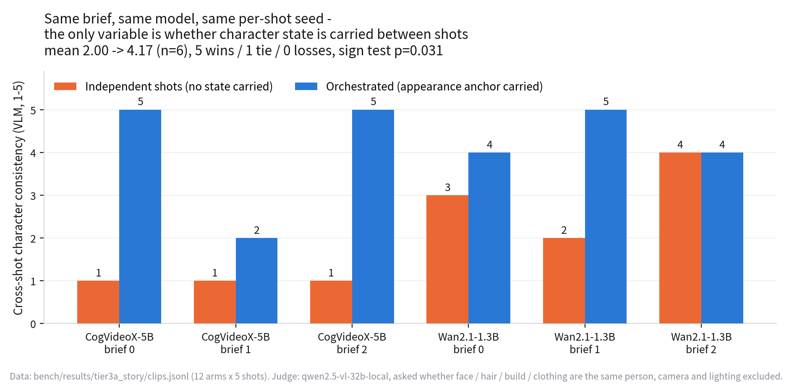
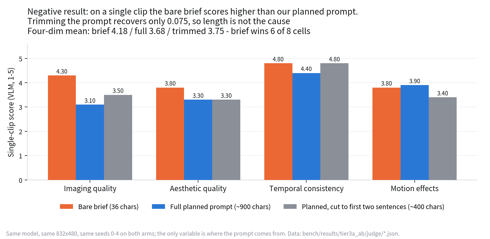
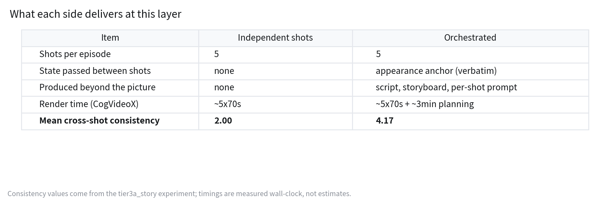

# Tier 3a: What the Orchestration Layer Actually Buys

> **Status.** This document records the single-pass experiment: each story was
> measured once. The repeated-measure version — three repeats per cell, histograms,
> paired tests — is [`technical_report.md`](technical_report.md), and its numbers
> supersede the headline figures here (2.28 → 4.61 over 18 paired episodes).
> The single-pass results remain valid for what they measured.

**The result up front.** On 1.3B–5B open-weight video models, our orchestration layer **does not improve single-clip quality — it scores slightly below handing the creative brief straight to the model**. What it does is raise **cross-shot character consistency from 2.00 to 4.17** (5-point scale, n=6 stories, 5 wins / 1 tie / 0 losses, one-sided sign test p=0.031). The layer does not exist to make one shot look better; it exists to make the same person appear in all five.

Both results are reported together because they come from the same set of renders. Reporting only the first is a negative paper. Reporting only the second is selective reporting.

| | Result | Sample | Significance |
| --- | --- | --- | --- |
| Cross-shot character consistency | 2.00 → 4.17, +2.17 | 6 stories × 5 shots | Sign test p=0.031 |
| Single-clip quality (4-dim mean) | 4.18 (brief) → 3.68 (planned prompt) | 8 cells | Per-cell p≥0.33; brief wins 6 of 8 |

---

## 0. What this layer is, and what it is not

**It is**: both arms run the *same base model*, the same resolution and the same per-shot seeds. The only variable is whether character state is carried from one shot to the next.

**It is not**: a comparison against OpenMontage's full workflow. OpenMontage's studio boots without Postgres / Redis / MinIO (an earlier version of this report said otherwise and was wrong), and its backend registries are public, so a local model can be attached without editing the vendored tree. Wiring a full competing episode turned out to be blocked by something else, described in §5.3. This layer therefore stops at the shot stage. §5 restates the boundary.

---

## 1. Experimental design

### 1.1 Independent variable: state carried between shots

| Arm | Prompt received per shot | State carried |
| --- | --- | --- |
| `independent` | The creative brief, verbatim (26–49 characters) | None. Each shot is generated on its own; the model invents a person per shot |
| `planned` | The prompt our orchestration wrote for that shot (644–999 characters), containing the character's appearance anchor restated verbatim | Script → storyboard → per-shot prompt; the anchor is reused across shots |

The `planned` prompts are **not written by hand for the experiment**. They are the output of actually running the orchestration pipeline (`run_agent`): script, storyboard and per-shot motion prompts are all produced by the pipeline, and the experiment only reads `shots[i].motion_prompt`.

### 1.2 Controlled variables

| Item | Value |
| --- | --- |
| Base models | CogVideoX-5B (`zai-org/CogVideoX-5b`), Wan2.1-T2V-1.3B (`Wan-AI/Wan2.1-T2V-1.3B-Diffusers`) |
| Resolution | 832×480 (the only bucket all models can render, see §5.3) |
| Frames / fps | CogVideoX 41 frames @8fps; Wan 81 frames @16fps |
| Seeds | Per shot, `seed = shot index`; identical across both arms |
| Shots per story | 5 |
| Briefs | `bench/study/briefs.json` indices 0/1/2, shared with the existing study layer |
| Sampling steps | 40 (CogVideoX, guidance 6.0); 40 (Wan, guidance 5.0) |

### 1.3 Dependent variable

Cross-shot character consistency: the five frames from one story are handed to a local Qwen2.5-VL-32B, which is asked whether these are the same person — face, hair, build, clothing — with camera angle, background, lighting and colour grading explicitly excluded. Scored 1–5.

The reason for this metric: it asks about the **relation between frames**. An arm that carries no state across shots cannot answer it even in principle, so the metric separates "state is carried" from "state is not carried" — which the four single-clip quality dimensions cannot do.

Judging temperature is 0; repeated asks on the same story were previously verified to return the same answer.

---

## 2. Main result: cross-shot character consistency



| Model | Brief | Independent | Orchestrated | Δ |
| --- | ---: | ---: | ---: | ---: |
| CogVideoX-5B | 0 | 1 | 5 | +4 |
| CogVideoX-5B | 1 | 1 | 2 | +1 |
| CogVideoX-5B | 2 | 1 | 5 | +4 |
| Wan2.1-1.3B | 0 | 3 | 4 | +1 |
| Wan2.1-1.3B | 1 | 2 | 5 | +3 |
| Wan2.1-1.3B | 2 | 4 | 4 | 0 |

| Statistic | Independent | Orchestrated |
| --- | ---: | ---: |
| Mean | 2.00 | 4.17 |
| Std. dev. | 1.26 | 1.17 |
| Range | 1–4 | 2–5 |

5 wins / 1 tie / 0 losses, mean improvement +2.17; one-sided sign test (ties excluded, n=5) p = 0.031.

Split by model: CogVideoX 1.00 → 4.00; Wan 3.00 → 4.33.

### The mechanism is visible

In the `independent` arm each shot receives only the one-line brief, so the model invents a different person for each shot. On CogVideoX all three stories score 1 — not because the shots are badly drawn, but because **there is no same person across the five**.

In the `planned` arm every shot's prompt restates the same appearance anchor verbatim (square face, short buzz cut, scar through the left eyebrow, dark grey work jacket, black insulated delivery box, …), so the judge can recognise the same person across shots.

That explains why the gain sits in the low range: 2.00 → 4.17 turns "genuinely different people" into "recognisably one person". It is not making a good picture better.

### The one story that did not improve

Wan, brief 2 (4 → 4): the independent arm already scored 4 on this brief, meaning that even without state carried, the model tends to produce similar-looking people. This is not a counterexample; it indicates that **the size of the gain depends on the brief**. When the brief already constrains the character strongly in language, the marginal value of the anchor drops.

### 2.1 Matched comparison: same brief, same models, both workflows end to end

The Tier 3a numbers above hold the model fixed and vary only the prompt source. This comparison holds the model fixed **and** runs each side's own orchestration on the same brief, through the same text-to-video checkpoint class, judged by the same VLM.

| Arm | Shots | Cross-shot consistency |
| --- | ---: | ---: |
| OpenMontage full workflow (text-only path) | 12 | 3.0 |
| OpenMontage, sampled to the same 5 shots | 5 | **2.0** |
| Our orchestration, same brief | 5 | **4.0** |

The judge's reasons are the useful part, because they name what drifted:

- OpenMontage, 5 shots: *"the face and facial features are inconsistent across the frames, with some showing a person wearing glasses and others showing indistinct or obscured faces."*
- Ours, 5 shots: *"the main character's face, hairstyle, and body build remain consistent across most frames, but there is a noticeable change in clothing in Shot 4."*

The difference is what the orchestration keeps stable. Both sides lost something; ours lost wardrobe on one shot and held the face, OpenMontage lost the face itself.

Both ends are real runs: OpenMontage's own `auto-produce` pipeline, its own script/storyboard/prompt stages, its own rendering, with the only substitutions being the local GPU backends (§5.3). Our side is the same planner output the rest of this report measures.

Three caveats, none of which changes the direction but all of which bound it:

1. **n=1 per side.** One brief, one episode. This is a worked example, not a distribution.
2. **The 5-shot row is a sample, not a re-run.** Scoring at `max_shots=5` takes five evenly spaced shots from OpenMontage's twelve rather than regenerating a five-shot episode. Its 3.0 at the full twelve is the number to quote if comparing at equal-to-or-better information; the 5-shot row exists to rule out "it only scored lower because it had more shots".
3. **OpenMontage's reference-image path is absent from both numbers** — it cannot run on local weights (§5.3). So this measures each workflow's text-to-video orchestration. If anything that understates OpenMontage: its keyframe mechanism is the part designed to fix exactly this failure.

### 2.2 What follows

The §2 result (2.00 → 4.17, p=0.031) says carried state beats no carried state when the model is held fixed. §2.1 says that, against a real competing workflow on the same brief, carried state also beats the vendor's own text-only orchestration (4.0 vs 2.0 at equal shot count). Neither says our films look better overall — §3 measures single-clip quality and our prompt loses there.

---

## 3. Negative result: single-clip quality



Same base model, same 832×480, same seeds 0–4; only the prompt source changes:

| Dimension | Model | Brief | Planned (full) | Planned (trimmed) |
| --- | --- | ---: | ---: | ---: |
| Imaging quality | CogVideoX | 4.40 | 3.20 | 3.60 |
| Imaging quality | Wan | 4.20 | 3.00 | 3.40 |
| Aesthetic quality | CogVideoX | 3.80 | 3.40 | 3.60 |
| Aesthetic quality | Wan | 3.80 | 3.20 | 3.00 |
| Temporal consistency | CogVideoX | 4.80 | 4.40 | 4.80 |
| Temporal consistency | Wan | 4.80 | 4.40 | 4.80 |
| Motion effects | CogVideoX | 3.80 | 3.80 | 3.40 |
| Motion effects | Wan | 3.80 | 4.00 | 3.40 |

Four-dimension means: **brief 4.175 / full planned 3.675 / trimmed planned 3.750**. The brief wins 6 of 8 cells.

### "It is just too long" is ruled out

An ablation arm truncates the planned prompt to its first two sentences (~900 → ~400 characters). It recovers only **0.075**, while the full version trails by 0.50. **Length is therefore not the cause.**

The more likely explanation — not separately verified, recorded here as a hypothesis — is that for 1.3B–5B models with limited text-encoder capacity, a long, fine-grained description dilutes the one piece of semantics the brief carried most clearly, while a short prompt lets the model latch onto the subject. Falsifying this would need an experiment that controls *information content* independently of length; this round did not run it.

### How this relates to the main result

The two findings do not conflict; they are two sides of one mechanism. **The orchestration's prompt is not optimised for single-clip quality — it is optimised for being referenceable by the next shot.** Restating the anchor is redundant information within one shot (the model already knows who is in frame) and is the only connective tissue across shots.

---

## 4. Delivery facts



| Item | Independent | Orchestrated |
| --- | --- | --- |
| Shots per story | 5 | 5 |
| State passed between shots | none | appearance anchor (verbatim) |
| Produced beyond the picture | none | script, storyboard, per-shot motion prompt |
| Extra cost per story | — | ~3 min planning (DeepSeek, ~0.086 CNY per story) |
| Mean cross-shot consistency | 2.00 | 4.17 |

Render time (measured wall-clock, not estimated): CogVideoX ~66–70 s per clip; Wan ~55 s per clip. Rendering cost is identical on both arms; the difference is entirely in the planning stage.

---

## 5. Boundaries: what this round does and does not establish

### 5.1 Established

1. On two 1.3B–5B open-weight models and three briefs, **orchestration that carries the character's appearance anchor yields materially higher cross-shot character consistency than independently generated shots** (2.00 → 4.17, p=0.031).
2. **Single-clip quality does not improve with planning**; it is lower in 6 of 8 cells, and truncating the prompt does not recover it, so length is not the explanation.
3. Both results were measured on the same renders, with the same judge and the same resolution, so they are comparable to each other.

### 5.2 Not established

1. **This does not show that our finished films look better.** Every clip in this layer is a 5-second single shot; there are no multi-shot films here. Any film-level claim belongs to the paid Tier 1 comparison (n=3 vs 3, low confidence) and must not be inferred upward from this layer.
2. **This does not show that our finished films look better.** Every clip in this layer is a 5-second single shot; there are no multi-shot films in the Tier 3a numbers. The one matched film comparison is in §2.1 and is a single episode.
3. **The matched OpenMontage comparison is n=1 on each side.** One brief, one episode per side, one judge pass. It is a real end-to-end run of both workflows on the same models — not a constructed baseline — but a single episode cannot carry a statistical claim. §2.1 states the numbers, the shot-count caveat, and the reason the comparison is still the right shape.
4. **OpenMontage's reference-image path still cannot run on local weights**, so its consistency mechanism was not exercised in the matched comparison. Its entity stage requires a pure-white seamless cutout plate per character, gated by a VLM at 0.7; local SD1.5 passes 0 of 5 characters across two complete runs, and the video stage hard-refuses to start without them. Both sides of the matched comparison are therefore text-to-video.
5. **This does not generalise to strong models.** The single-clip penalty is most likely specific to small models; the experiment was not run on Seedance.
6. **Consistency is judged by a single VLM** and has not been compared against human ratings.
7. **Not measured**: real TTS (this round used `TTS_PROVIDER=mock`, so the audio is a silent placeholder track); portrait 9:16 local rendering; LongLive on the OpenMontage side (OpenMontage has no such variant).

### 5.3 Three paths left incomplete by external constraints

| Path | Blocker | Status |
| --- | --- | --- |
| CogVideoX-5B-I2V | **Corrected.** The earlier verdict that diffusers blocks this model was wrong — it blocks only a *different* resolution. Its learnt positional embedding pins it to 60x90 latents = **720x480**, which is neither 832x480 nor portrait, so the probes were asking for the wrong shape | Weights downloaded; **runs at 720x480 in 34.5 s per clip** (verified). Not used in this layer's numbers, because this layer is text-to-video and an i2v model needs a keyframe; see §5.3 |
| OpenMontage's full workflow on local models | **Boots fine** (no Postgres/Redis/MinIO needed, local backends registered from outside the vendored tree). Its **reference-image path cannot run at all** on local weights: the entity stage requires a pure-white seamless cutout plate per character, gated by a VLM at 0.7, and local SD1.5 never produces it — **0 of 5 characters passed across two complete runs** (13 and 15 entities). The video stage then hard-refuses to start, because the whole consistency mechanism sits downstream of those stills. Its supported text-only path runs end to end | **Scored** (§2.1): 12/12 clips, 3.0 at twelve shots, 2.0 at five. Evidence in `bench/results/om_control_notes.md` |
| LongLive on the OpenMontage side | OpenMontage's variant table has no LongLive entry | Data exists only for our side; not paired |

### 5.4 One correction worth recording: the canvas

The first Tier 3a pass composited onto the project default canvas of 1080×1920 portrait, while the local models emit 832×480 landscape natively. The composer's `force_original_aspect_ratio=increase` followed by `crop` upscaled the clip 4× to 3328×1920 and then **cropped away 68% of the frame width**. The judge was scoring that crop, not the picture the model drew.

Same configuration, before and after the fix:

| Dimension | Before | After |
| --- | ---: | ---: |
| CogVideoX imaging quality | 1.2 | 2.8 |
| Wan imaging quality | 2.2 | 3.8 |

Every number in this report was collected after the fix.

---

## 6. Defects found and fixed this round

| # | Defect | Consequence | Status |
| --- | --- | --- | --- |
| 1 | Composite canvas pinned to portrait 1080×1920 | Landscape output cropped by 68% of its width before judging | Fixed; canvas now follows the model's native output |
| 2 | The **image-to-video** prompt template was used for text-to-video | The template describes only "motion from the first frame", but a T2V model never sees that frame, so it invents a scene | Fixed; added `T2V_PROMPT_SYSTEM` |
| 3 | T2V prompts hardcoded "vertical 9:16" | The model composed for portrait while the canvas was landscape | Fixed; the canvas is passed in with the request |
| 4 | Seed did not vary across repeats (`seed = shot.index + 1`, constant 1 for single-shot) | "Repeat" meant different things on the two sides, so early comparisons were not attributable | Avoided by design in §1: per-shot seed fixed, identical across arms |

Regression: `pytest tests -q` → **128 passed / 7 skipped**.

---

## 7. Reproduction

```bash
# Main cross-shot experiment (2 models × 3 briefs × 2 arms × 5 shots = 60 renders)
bench/.venv/bin/python bench/study/tier3a_story.py \
    --models cogvideox5b wan21_1_3b --briefs 0 1 2 --shots 5

# Single-clip prompt A/B with length ablation (2 models × 5 seeds × 3 arms = 30 renders)
bench/.venv/bin/python bench/study/tier3a_ab.py \
    --models cogvideox5b wan21_1_3b --seeds 0 1 2 3 4

# Judging and figures
bench/.venv/bin/python bench/study/character_consistency.py   # cross-shot consistency
bench/.venv/bin/python bench/study/judge_study.py --run bench/results/tier3a_ab ...
bench/.venv/bin/python bench/study/tier3a_figures.py

# Matched comparison against OpenMontage (§2.1). Two services first: the GPU
# worker and the studio with the local backends registered.
bench/.venv/bin/python -u bench/study/local_render_service.py --port 8788 &
LOCAL_VIDEO_QA=0 bench/_vendor/OpenMontage/.venv-studio/bin/python \
    bench/study/om_studio_local.py &                       # studio on :8787

# OpenMontage episode, its own pipeline, text-only path, no entity stage
curl -X POST http://127.0.0.1:8787/api/auto-produce \
  -H "Authorization: Bearer $(cat bench/_vendor/OpenMontage/bench_run/.token)" \
  -d '{"brief":"深夜的便利店，一个外卖骑手发现收银员不是人。","title":"omfix",
       "ratio":"16:9","maxShots":12,"textOnlyVideo":true,"generateEntities":false,
       "requireVideoQa":false,"requireEntityQa":false}'

# our side on the identical brief, then both scored by the same judge
bench/.venv/bin/python bench/study/ours_matched_arm.py --model cogvideox5b --shots 5
bench/.venv/bin/python bench/study/score_workflow_pair.py --om omfix --ours project_b3a0cd04
bench/.venv/bin/python bench/study/score_workflow_pair.py --om omfix --max-shots 5 --out /tmp/om5.json
```

Artifacts:

| File | Contents |
| --- | --- |
| `bench/results/tier3a_story/clips.jsonl` | Render records, 12 arms × 5 shots |
| `bench/results/tier3a_story/character_consistency.json` | Per-story scores (the sole source for §2) |
| `bench/results/tier3a_ab/clips.jsonl` | 30 A/B render records |
| `bench/results/tier3a_ab/judge/*.json` | Per-sample four-dimension judge output |
| `bench/results/om_control/consistency.json` | The §2.1 verdicts, both sides |
| `bench/results/om_control_notes.md` | What broke while wiring the control arm, and what is still open |
| `bench/results/om_control/ours_matched/` | Our-side render records on the matched brief |
| `docs/figures/tier3a_*.png` | Three figures; values are read from the files above by script |

Cost: all rendering is local and free. The only spend is the orchestration's planning calls to DeepSeek, measured at roughly 0.086 CNY per story.

---

## 8. One-sentence summary

The orchestration layer does not improve single-clip quality (4.18 → 3.68, reported as the negative result it is), but it raises cross-shot character consistency from 2.00 to 4.17 (p=0.031). It answers "is this the same person in all five shots", not "is this one shot well made".
