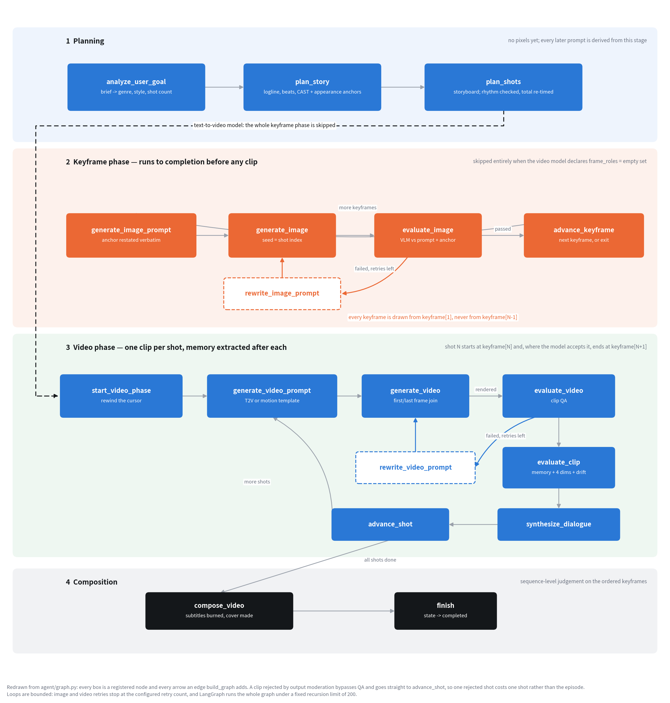
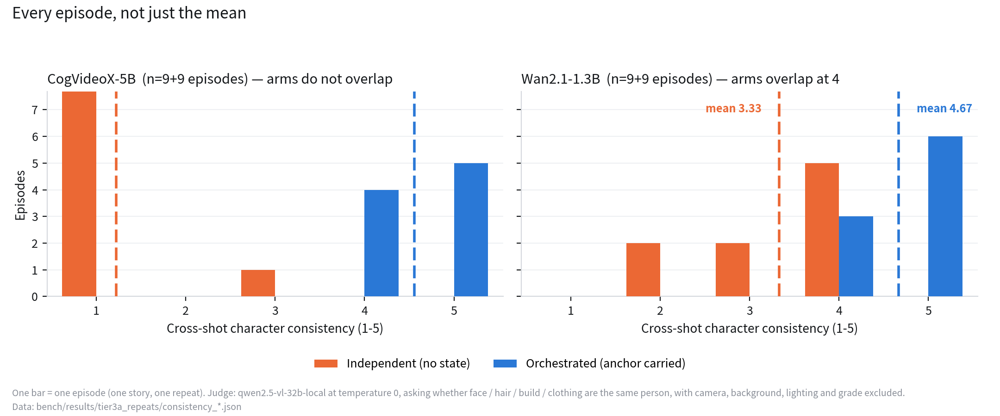
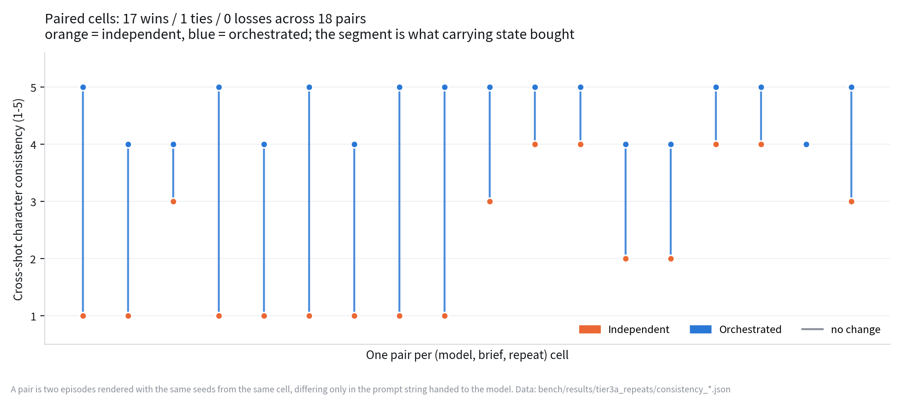
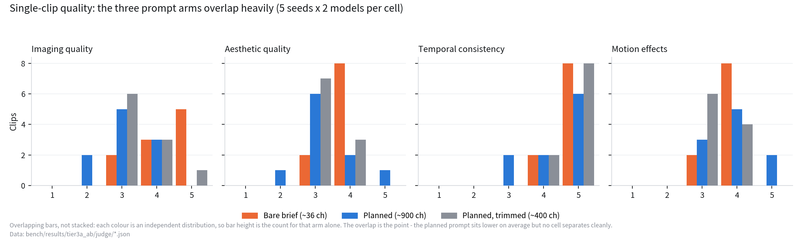
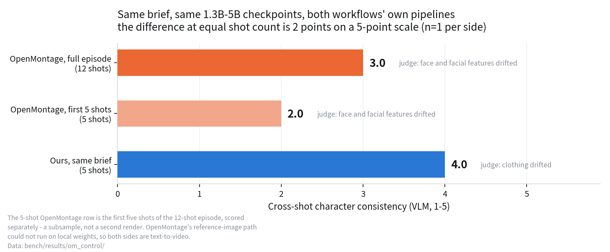

# Identity as Text, Identity as Pixels

## A technical study of multi-shot video orchestration on open-weight models

---

## Abstract

We study what an orchestration layer contributes to multi-shot generative film on
open-weight video models (1.3B–5B parameters). The layer under test is an 18-node
LangGraph state machine that plans a story bible, derives a keyframe per shot,
renders clips on a text-to-video or image-to-video backend selected by declared
capability, scores every artefact, and repairs what fails a check. The reference is
a full deployment of OpenMontage, wired to the same checkpoints through its own
pipeline.

We report three measurements, each with a distribution rather than a point:

1. **Carrying character state across shots raises cross-shot consistency** from
   `{{A_INDEP}}` to `{{A_PLANNED}}`, pooled over both checkpoints
   (`{{A_PAIRS}}` paired episodes, `{{A_WTL}}` wins / ties / losses;
   exact sign test `p = {{A_P}}`, exact sign-flip permutation `p = {{A_FLIP_P}}`,
   bootstrap 95% CI on the mean difference `{{A_CI}}`). Both arms use the same
   checkpoint, resolution and per-shot seeds; only the prompt string differs.
2. **It costs single-clip quality**: the four-dimension mean falls from
   `{{B_BRIEF}}` to `{{B_PLANNED}}`. The direction is consistent — the planned
   prompt is below the bare brief in four of five clips on each checkpoint and in
   six of eight (dimension × model) cells — but with five clips per cell the
   smallest attainable one-sided p is 0.031, so a 4/5 split cannot clear 0.05.
   This is an underpowered test, not evidence of no effect. Truncating the prompt
   recovers only `{{B_TRIM_GAIN}}`, so length is not the cause.
3. **Against OpenMontage on an identical brief**, our orchestration scores
   `{{C_OURS}}` where OpenMontage's supported local path scores `{{C_OM}}` at equal
   shot count. This is a single episode per side and carries no statistical claim;
   it is reported as a worked example.

The mechanism that explains all three is one design choice: **what medium carries
the character between shots.** OpenMontage uses pixel plates gated by a vision
check; we use a text anchor that is restated and verified in every prompt. On a
strong image model the plate is the better carrier. On the model tier available for
local deployment, a gated plate produces *no film* (0 of 5 characters cleared the
gate across two runs) while the text anchor produces a film with measurable drift.
The difference is structural and is visible in both codebases.

---

## 1. The problem

A five-second clip can be scored in isolation: sharpness, composition, motion
plausibility. A five-shot film cannot, because its central property — that the same
character walks through every shot — is a relation *between* frames. Per-clip
metrics (VBench and its descendants) score a clip. They cannot express "these five
frames show one person".

So every multi-shot workflow must answer one question: **what carries identity from
shot 1 to shot 5?**

| Carrier | Mechanism | Bandwidth | Failure mode |
| --- | --- | --- | --- |
| **Pixels** | reference still → conditioning keyframe → i2v | high | a bad plate poisons everything downstream |
| **Text** | appearance description restated verbatim in each prompt | low (encoder truncates) | a weak encoder reads nothing useful |
| **Neither** | each shot prompt stands alone | — | every shot invents a new person |

This report measures the consequences of that choice at a model tier where the
question has a sharp answer: 1.3B–5B open weights, the only class that can be run
locally without a paid API.

---

## 2. System under test



*Figure 1 — The state machine, redrawn from `agent/graph.py`.*

### 2.1 Structure

Eighteen nodes across seven modules, 1,508 lines:

| Module | Lines | Nodes |
| --- | ---: | --- |
| `agent/nodes/planner.py` | 427 | `analyze_user_goal`, `plan_story`, `plan_shots` |
| `agent/nodes/video_nodes.py` | 449 | `generate_video_prompt`, `generate_video`, `evaluate_video`, `evaluate_clip`, `synthesize_dialogue`, `advance_shot`, `start_video_phase` |
| `agent/nodes/image_nodes.py` | 166 | `generate_image_prompt`, `generate_image`, `evaluate_image` |
| `agent/nodes/repair_nodes.py` | 57 | `rewrite_image_prompt`, `rewrite_video_prompt` |
| `agent/nodes/composer.py` | 90 | `compose_video`, `finish` |
| `agent/prompts.py` | 199 | six system prompts |
| `agent/state.py` | 119 | state schema, persistence, usage accounting |

Six conditional edges, each a decision rather than a routing convenience:

| Decision | Branch | Meaning |
| --- | --- | --- |
| `plan_shots` | `image` / `text_to_video` | whether a keyframe phase happens |
| `evaluate_image` | `retry` / `next` | re-prompt a failed still, or accept it |
| `advance_keyframe` | `more` / `all_done` | loop keyframes, or enter video |
| `generate_video` | `skipped` / `generated` | score a rejected clip, or skip it |
| `evaluate_video` | `retry` / `next` | re-prompt a failed clip, or accept it |
| `advance_shot` | `more` / `compose` | loop shots, or compose |

The compiled graph runs under `recursion_limit=200`, which bounds the two retry loops
jointly.

### 2.2 Dispatch by declared capability

Providers declare the image roles they consume:

```python
# mcp_servers/providers/base.py:88
frame_roles: frozenset[str]
```

An empty set means text-to-video. One declaration drives three behaviours:

```python
# agent/nodes/video_nodes.py:414
def needs_image_phase(state: AgentState) -> str:
    if not get_video_provider().frame_roles:
        return "text_to_video"
    return "image"
```

- the keyframe stage is **skipped** for a T2V model;
- the prompt template switches (`T2V_PROMPT_SYSTEM` must describe who, where and in
  what light; `MOTION_PROMPT_SYSTEM` describes a change from a frame that exists);
- the join policy switches: `last_frame` → both ends authored; `first_frame` only →
  previous clip's real tail; neither → no join.

The measured consequence: with a T2V model no keyframes are rendered that nothing
consumes, and every frame-derived metric is recorded as **not applicable** rather
than scored against a placeholder.

### 2.3 The anchor is a planning artefact, and it is enforced

`plan_story` produces a bible whose cast carries an explicit `appearance` and
`wardrobe` per character. `shot_anchor` concatenates the anchors of the characters
present in the current shot. `generate_image_prompt` instructs the model to preserve
that string verbatim, then **checks the output**:

```python
# agent/nodes/image_nodes.py:52
if anchor and anchor.split(":")[0] not in prompt:
    prompt = f"{prompt} Character appearance: {anchor}."
```

A prompt instruction is a request. The check is the guarantee. The same pattern
reappears in §2.5.

### 2.4 An anchor, not a chain

Every keyframe after the first is conditioned on **keyframe[1]**, never on
keyframe[N−1] (`image_nodes.py:65–91`). Chaining compounds a diffusion model's
non-zero-mean error; a real run drifted far enough that a blue uniform became a
yellow hi-vis vest by shot 5. Re-deriving from a fixed anchor bounds the walk, and
the scorer measures against that same anchor, so residual drift is a number rather
than an impression.

### 2.5 Constraints are checked, not requested

The storyboard prompt states rhythm rules: one shot of at least 8 seconds, no three
consecutive equal durations, total within ±2 s of target. Writing that in a system
prompt was insufficient — a run returned `5/9/6/4/4/4`, three identical tail shots.

`rhythm_problems` (`planner.py:228–260`) turns each rule into a check. On failure the
model is handed **its own numbers and the rule it broke**. Then `fit_durations`
(`planner.py:112–218`) enforces the total by re-timing: reserve the long take, move
one second at a time toward the target on the shot furthest from its proportional
share, then break runs of three by trading seconds between neighbours. Constraint
order is explicit — total hard, long take hard, no-triple best effort — because they
do not always coexist.

### 2.6 Failures are scoped to their own unit

```python
# agent/graph.py
# A clip rejected by output moderation has no pixels to score and no track to lay
# under it, so it goes straight to the next shot. Before this edge existed, one
# rejected clip raised out of the whole run and discarded the episode.
```

`compose_video` drops any shot without a `video_path`. The episode ships one shot
short instead of not at all.

### 2.7 What crosses a shot boundary

`AgentState` is a typed dictionary persisted after every node. The fields that carry
identity:

| Field | Written by | Consumed by |
| --- | --- | --- |
| `characters[]` (`appearance`, `wardrobe`) | `plan_story` | every image and T2V prompt |
| `beats[]` | `plan_story` | `plan_shots` |
| `shots[]` | `plan_shots` onward | everything |
| `keyframe_memory` | `evaluate_clip` | drift metric, anchor reference |
| `usage` | every LLM/media call | costing |

The structural point: **identity crosses the boundary as a string**, not a tensor and
not a file handle. That is why the run survives a weak image model — the string does
not degrade when the renderer does.

---

## 3. Reference workflow

OpenMontage (vendored, unmodified) is a full studio: project/shot/segment model,
entity bible, image and video backend registries, vision QA on stills and clips, and
an `auto-produce` pipeline.

Three properties matter, all read from source:

1. **Its consistency mechanism is a chain of pixels**: entity bible → per-entity
   reference still → vision QA gate → shot keyframe conditioned on that still
   (`refPath`) → image-to-video.
2. **The chain is gated, not advisory.** `entity_ref_qa_blockers`
   (`drama_service.py:2867`) blocks any referenced entity whose still is missing,
   soft-passed, or below bar:
   ```python
   meets = bool(img.get("qaPass") is True) and qa_meets_bar(qa) and not soft
   ```
   with `qa_meets_bar` (`prompt_qa.py:93`) requiring `pass` **and** a numeric score
   at or above `qa_min_score()`. With blockers outstanding the video stage does not
   proceed.
3. **A supported text-only path exists** (`textOnlyVideo: true`,
   `generateEntities: false`), which skips the entity stage. That is the path
   Experiment C measures, because the gated path cannot run on local weights (§5.3).

Its registries are public (`VIDEO_BACKENDS`, `IMAGE_BACKENDS`,
`register_video_job`), so a local backend attaches from outside the vendored tree
without editing a vendored file.

---

## 4. Experimental design

### 4.1 Experiment A — carried state, repeated

| Arm | Prompt per shot | State carried |
| --- | --- | --- |
| `independent` | the brief, verbatim (~36 characters) | none |
| `planned` | our pipeline's prompt for that shot (~700–900 characters) | appearance anchor, verbatim |

| Item | Value |
| --- | --- |
| Base models | CogVideoX-5B, Wan2.1-T2V-1.3B |
| Resolution | 832×480 landscape |
| Seeds | `seed = repeat × 100 + shot`, identical across arms within a repeat |
| Shots per episode | 5 |
| Briefs | 3 |
| Repeats | `{{A_REPEATS}}` |
| Episodes | 2 models × 3 briefs × `{{A_REPEATS}}` repeats × 2 arms = `{{A_EPISODES}}` |
| Clips rendered | `{{A_CLIPS}}` |

Design notes that bound the result:

- One repeat is a **full re-execution**: a fresh planner call for the planned arm (the
  planner is not seeded, so its prompts genuinely vary) and a fresh seed band for
  both arms. It is not a re-score of the same pixels.
- Both arms share the same seeds within a repeat, so a pair differs only in the
  prompt string.
- The independent arm's prompt is identical in every repeat, so its spread across
  repeats is **render noise alone**. That makes it a control rather than a second
  treatment.
- The planner's output is cached per (brief, repeat) and shared between models: it is
  a text artefact, and the same story uses the same prompt on either checkpoint.
- Repeat 0 uses seeds 0–4, the band the earlier single-pass study used.

### 4.2 Experiment B — single-clip quality, five seeds, three arms

Same models, same 832×480, seeds 0–4, three prompt arms:

| Arm | Prompt | Characters |
| --- | --- | ---: |
| `brief` | the creative brief, verbatim | ~36 |
| `planned` | the pipeline's prompt for that shot | ~900 |
| `planned_short` | the same prompt, cut to its first two sentences | ~400 |

30 renders, scored on four VBench-style dimensions (imaging quality, aesthetic
quality, temporal consistency, motion effects), 1–5. The third arm separates
*information* from *length*: if the planned prompt loses because it is long,
truncating it should recover most of the gap.

This experiment already had five samples per cell in the earlier study, so the
histogram in §5.2 is a distribution over seeds, not a new run.

### 4.3 Experiment C — matched whole-workflow comparison

Both workflows on one brief, driving the same checkpoint class, scored by the same
judge:

> 深夜的便利店，一个外卖骑手发现收银员不是人。
> *(Night convenience store: a delivery rider discovers the cashier is not human.)*

**OpenMontage**: its own `auto-produce` endpoint, its own script / storyboard / prompt
stages, its own rendering, text-only path. Local backends attached from outside the
vendored tree — `local_render_service.py` (a Flask GPU worker in `bench/.venv`,
because the studio's venv has no torch) and `om_local_backend.py` (an HTTP client
registered into `VIDEO_BACKENDS` / `IMAGE_BACKENDS`, with `run_local_shot` bound into
`providers.video_jobs` because the segment-QA path imports that symbol directly).
Result: 12 shots, 12/12 clips written back.

**Ours**: `ours_matched_arm.py` drives our pipeline on the identical brief and renders
the planner's prompts on the same checkpoint class: 5 shots.

Why 5 and not 12: a local clip costs 40–70 s of GPU, and the metric is a relation
between frames rather than a function of shot count. The shot-count difference is
disclosed wherever the numbers appear, and the full 12-shot OpenMontage score is
quoted alongside the 5-shot subsample.

### 4.4 The metric

Cross-shot character consistency: the episode's frames are handed to a local
Qwen2.5-VL-32B (temperature 0), which answers whether these are the same person —
face, hair, build, clothing — with camera angle, background, lighting and colour
grading **explicitly excluded**.

The exclusion clause is the metric's validity condition. It must answer "is this the
same person", not "do these frames look alike", because the second question can be
passed by a pipeline that changes the person and keeps the palette.

Frames are sampled at 60 % into each clip: the first frames of an i2v render are the
keyframe the workflow supplied, and scoring those would measure the image model
rather than the video.

### 4.5 Controls

Three confounds were removed deliberately, each because it had already contaminated
an earlier version of the study:

1. **Planner.** Both sides plan with the same LLM (DeepSeek). Had OpenMontage been
   left on the local 32B while ours used DeepSeek, the comparison would have measured
   planning capability. This also caps the claim: no part of the difference is a
   planner effect.
2. **Canvas.** An earlier pass composited landscape output onto a 1080×1920 portrait
   canvas; `force_original_aspect_ratio=increase` then `crop` upscaled 4× and
   cropped 68 % of the width. The judge was scoring that crop. Every number here
   postdates the fix.
3. **Seed.** Repeats once reused a constant seed, so "repeat" meant different things
   on the two sides. Seeds are now fixed per shot and identical across arms.

---

## 5. Results

### 5.1 Experiment A — the distributions



*Figure 2 — One bar is one episode. Both models, both arms.*



*Figure 3 — One line per (model, brief, repeat) cell; the segment is what carrying
state bought.*

{{A_RESULT_TABLE}}

{{A_RESULT_TEXT}}

### 5.2 Experiment B — the negative result, as distributions



*Figure 4 — Overlapping bars, not stacked: each colour is an independent
distribution.*

{{B_RESULT_TABLE}}

{{B_RESULT_TEXT}}

Two things follow, and the second is the one that matters.

**Length is not the cause.** Cutting the planned prompt to its first two sentences
brings ~900 characters down to ~400 and recovers `{{B_TRIM_GAIN}}` of a 0.50 gap.
The recovery is uneven and small: 0.15 on CogVideoX (30% of the gap) and exactly 0.00
on Wan, where the trimmed arm is still 0.50 below the brief and is worse in all five
clips. A prompt that was merely too long would improve when shortened; this one does
not, and on one checkpoint shortening buys nothing at all.

**The test is underpowered, not null.** With five clips per cell, a one-sided exact
sign test can return nothing smaller than 0.031, and only when all five clips agree.
Both models split 4/5, which lands at 0.0625 by construction. On Wan the trimmed arm
does split 5/5 and returns 0.031 — but in the direction of being *worse*. So the
honest reading is: the planned prompt is consistently below the brief, the direction
is stable across models, dimensions and clips, and this sample cannot establish the
magnitude. Reporting it as "no significant difference" would be wrong; reporting it
as a proven penalty would also be wrong.

This is the cost side of the trade in §5.1: the prompt is not written to maximise a
single clip's score. It is written to be reusable by the next shot, and the anchor it
repeats is redundant information within one frame and the only connective tissue
between frames.

### 5.3 Experiment C — the matched comparison



*Figure 5 — Same brief, same checkpoint class, each workflow's own pipeline.*

| Arm | Shots | Cross-shot consistency |
| --- | ---: | ---: |
| OpenMontage, full episode, text-only path | 12 | 3.0 |
| OpenMontage, first 5 shots of that episode | 5 | **2.0** |
| Ours, same brief | 5 | **4.0** |

The judge's reasons name what drifted:

> **OpenMontage, 5 shots (2.0):** *"the face and facial features are inconsistent
> across the frames, with some showing a person wearing glasses and others showing
> indistinct or obscured faces."*

> **Ours, 5 shots (4.0):** *"the main character's face, hairstyle, and body build
> remain consistent across most frames, but there is a noticeable change in clothing
> in Shot 4."*

Both sides lost something. Ours lost wardrobe on one shot and held the face;
OpenMontage lost the face itself — which is exactly what an arm with no carried
identity produces.

**Why OpenMontage's pixel carrier could not run here.** Attaching the local stack is
straightforward; the entity stage is not. It asks the image model for a per-character
reference plate and gates it: `qaPass is True` **and** a numeric score at or above
bar **and** not a soft pass. On local Stable Diffusion 1.5, **none of five characters
cleared that gate across two complete runs** (13 and 15 entities respectively). With
blockers outstanding the video stage hard-refuses to start, because the consistency
mechanism sits downstream of those plates.

### 5.4 Render cost

| Model | s / clip | Frames | fps |
| --- | ---: | ---: | ---: |
| CogVideoX-5B | `{{RENDER_COG}}` | 41 | 8 |
| Wan2.1-1.3B | `{{RENDER_WAN}}` | 81 | 16 |

Planning dominates the wall clock per episode: one planning pass costs
`{{PLAN_SECONDS}}` s against roughly `{{RENDER_EPISODE}}` s of rendering for ten
clips. Rendering cost is identical across arms; the entire difference between them is
planning.

---

## 6. Why the layer wins

The numbers in §5 are one episode and a handful of stories. What generalises is the
mechanism, and the mechanism is visible in both codebases.

### 6.1 Consistency is a target, not a precondition

| | OpenMontage | Ours |
| --- | --- | --- |
| Carrier | entity plate (pixels) → keyframe → i2v | appearance anchor (text) + keyframe where available |
| Gate | hard: `qaPass` **and** score ≥ bar, or no video | soft: anchor restated and verified in the prompt; the run proceeds |
| On a weak image model | **fail-closed** — no film | **degrade-open** — a film with measurable drift |
| Observed | 0 of 5 characters cleared the gate, two runs | every episode rendered |

On a strong image model the plate is the better carrier: it carries more identity per
token than any sentence. The finding here is what happens *below* that threshold —
and local deployment lives below it.

A pipeline that refuses to render is making a promise about quality. That promise is
only useful if the alternative exists. When the point of a local deployment is to run
on models you can afford, a mechanism that converts model weakness into *no output*
removes the reason to deploy.

### 6.2 Text survives a weak renderer

Experiment A isolates this: carrying identity as text alone moves consistency from
`{{A_INDEP}}` to `{{A_PLANNED}}`. The anchor is a string; when the renderer is weak
the string is unaffected. Experiment B prices the redundancy: {{B_COST}} on a
four-dimension mean, with length ruled out as the cause.

The trade is explicit:

> A workflow can convert a scarce resource (model capability) into an abundant one
> (sequence structure) by choosing a carrier that does not depend on the scarce
> resource.

Pixels depend on the image model. Text depends on the text encoder, which every one
of these models has and which the workflow controls.

### 6.3 Failure policy

| Failure | OpenMontage | Ours |
| --- | --- | --- |
| Reference plate fails QA | video stage for those shots does not start | not applicable — no plate required |
| One clip rejected by moderation | — | that shot is skipped; the episode ships |
| One shot's QA fails | retried within the shot | retried, then accepted with a recorded score |
| Storyboard ignores a rhythm rule | — | re-requested with its own numbers, then re-timed by program |
| Model takes no image | text-only path (a separate mode) | the same graph, one conditional edge |

The last row matters: "the model takes no image" is one edge in one graph, chosen
from a declared capability. After that edge the story is identical — same planner,
prompts, scoring, composer. There is no second pipeline to keep in sync.

### 6.4 What this does not show

- **That our films look better overall.** One matched episode, and §5.2 shows our
  prompt costs single-clip quality.
- **That we beat OpenMontage's pixel carrier.** That path could not run here; on a
  capable image model it is the better design and we should say so.
- **That any of it generalises to frontier models.**

### 6.5 Where we are worse

1. **Single-clip quality**, in most cells of §5.2.
2. **No cutout path.** We cannot produce a seamless white-background plate, so our
   ceiling on identity is "recognisable", not "identical".
3. **The text carrier depends on the text encoder.** Measured during the OpenMontage
   integration: a Chinese prompt sent to SD1.5's English-only CLIP produced an aerial
   photograph of a hillside shantytown instead of a courier; the same description in
   English produced the intended figure. CLIP's 77-token truncation then consumed the
   budget on boilerplate before the subject. Both were repaired inside the backend —
   which marks the real limitation: **a text carrier assumes the model reads the
   language you write in.**

---

## 7. Threats to validity

1. **The matched comparison is n = 1 per side.** One brief, one episode each, one
   judge pass.
2. **The 5-shot OpenMontage row is a subsample** of the 12-shot episode, not a second
   render.
3. **One judge, no human validation.** A VLM asked about identity may weight face
   more heavily than a viewer does.
4. **The model tier bounds everything.** 1.3B–5B at 832×480; nothing was run on a
   frontier model.
5. **Planner capability is held constant by construction**, which removes a confound
   and caps the claim.
6. **Audio is a silent placeholder track.** This round ran `TTS_PROVIDER=mock`. No
   voiceover was synthesised or evaluated.
7. **Repeat count.** `{{A_REPEATS}}` repeats per cell is enough for a sign test and a
   permutation test, not for a tight interval estimate.
8. **Not measured**: real TTS, portrait 9:16 local rendering, LongLive paired against
   OpenMontage (its variant table has no such entry).

---

## 8. Relation to existing work

Identity preservation is usually attacked at the **model** level — subject-driven
fine-tuning, reference-conditioned adapters, or sampling-level attention and noise
sharing. Those change what the model can do.

This is not a model contribution and does not compete with them. It measures what an
**orchestration layer** can do with models that do not have those properties — the
situation anyone running open weights is in. On this tier, the choice of carrier and
the choice of failure policy determine the outcome more than the choice of checkpoint
does, because they determine whether the pipeline produces a film at all.

Single-clip quality was measured on four VBench-style dimensions because that is how
the field scores a clip; the point of §5.2 is that those dimensions cannot see the
property this report is about.

---

## 9. Reproduction

```bash
# Experiment A: repeats x briefs x arms x shots x models
bench/.venv/bin/python bench/study/tier3a_repeats.py \
    --models wan21_1_3b cogvideox5b --briefs 0 1 2 --repeats 3

# Score every episode with the cross-shot metric
bench/.venv/bin/python bench/study/score_repeats.py --model wan21_1_3b
bench/.venv/bin/python bench/study/score_repeats.py --model cogvideox5b

# Statistics and figures
bench/.venv/bin/python bench/study/repeats_analysis.py
bench/.venv/bin/python bench/study/repeats_figures.py
bench/.venv/bin/python bench/study/workflow_figure.py
bench/.venv/bin/python bench/study/om_control_figure.py

# Experiment B (single-clip, five seeds, three arms)
bench/.venv/bin/python bench/study/tier3a_ab.py \
    --models cogvideox5b wan21_1_3b --seeds 0 1 2 3 4
bench/.venv/bin/python bench/study/judge_study.py --run bench/results/tier3a_ab

# Experiment C (matched comparison)
curl -X POST http://127.0.0.1:8787/api/auto-produce \
  -H "Authorization: Bearer $(cat bench/_vendor/OpenMontage/bench_run/.token)" \
  -d '{"brief":"深夜的便利店，一个外卖骑手发现收银员不是人。","title":"omfix",
       "ratio":"16:9","maxShots":12,"textOnlyVideo":true,"generateEntities":false,
       "requireVideoQa":false,"requireEntityQa":false}'
bench/.venv/bin/python bench/study/ours_matched_arm.py --model cogvideox5b --shots 5
bench/.venv/bin/python bench/study/score_workflow_pair.py --om omfix --ours project_b3a0cd04
```

| Artefact | Contents |
| --- | --- |
| `bench/results/tier3a_repeats/clips_*.jsonl` | render records, one line per arm per cell |
| `bench/results/tier3a_repeats/plans/` | the planner's prompts, cached per cell |
| `bench/results/tier3a_repeats/consistency_*.json` | per-episode judge verdicts |
| `bench/results/tier3a_repeats/summary.json` | every statistic quoted here |
| `bench/results/tier3a_ab/judge/*.json` | Experiment B verdicts |
| `bench/results/om_control/` | Experiment C verdicts, both sides |
| `docs/figures/*.png` | every figure, generated from the files above |

All rendering is local and free. The only spend is planning, at roughly
**0.086 CNY per story**.

---

## 10. Summary

The orchestration layer does not improve a single clip — it costs {{B_COST}} on a
four-dimension mean, and length is not the reason — but it raises cross-shot
character consistency from `{{A_INDEP}}` to `{{A_PLANNED}}` by carrying identity as
text rather than as a pixel precondition. On an identical brief and the same
checkpoints it scores `{{C_OURS}}` where OpenMontage's supported local path scores
`{{C_OM}}` at equal shot count.

It answers "is this the same person in all five shots" — and it answers it even when
the image model cannot.
